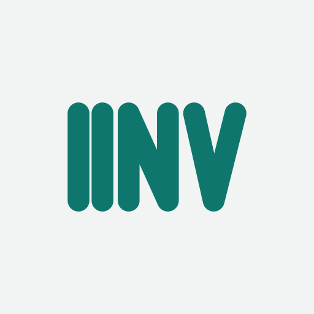
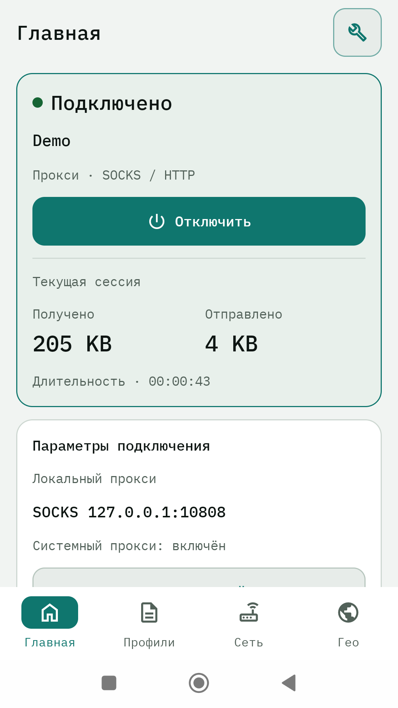
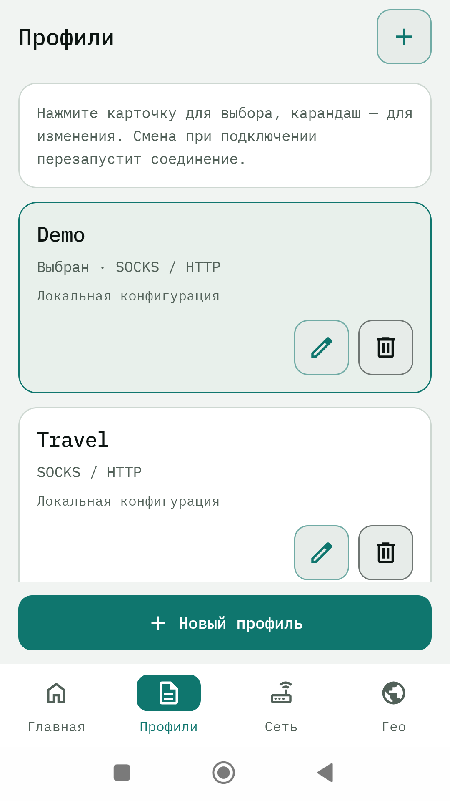
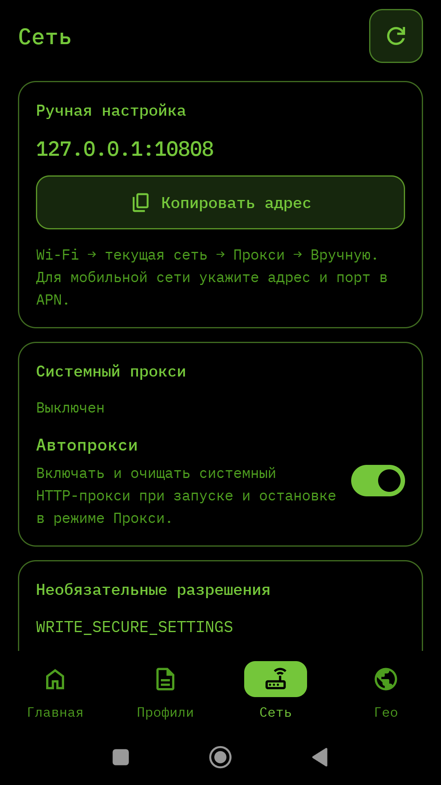
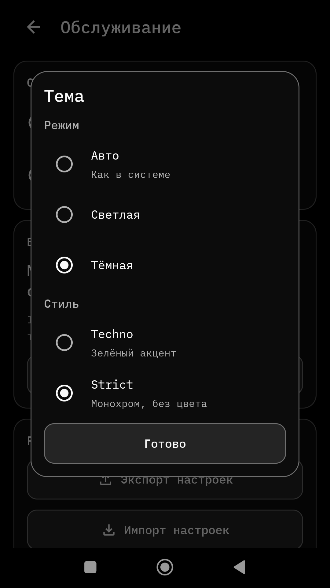
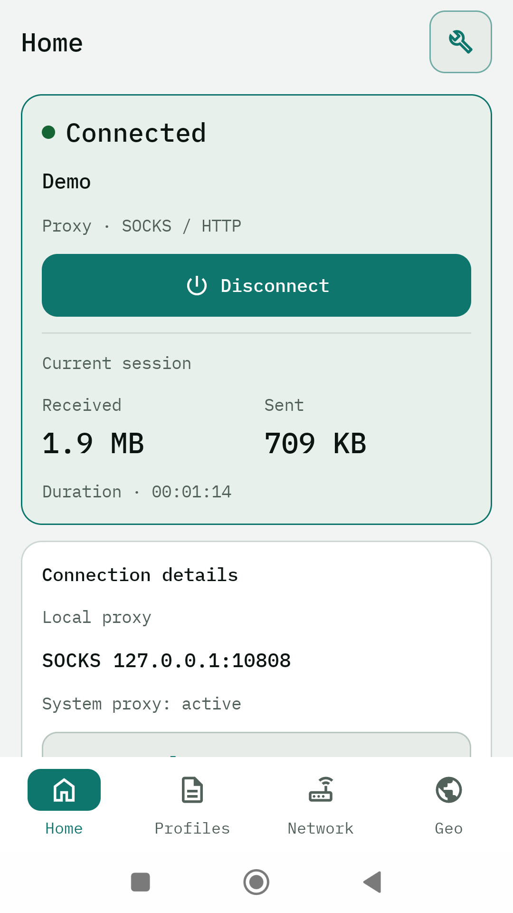
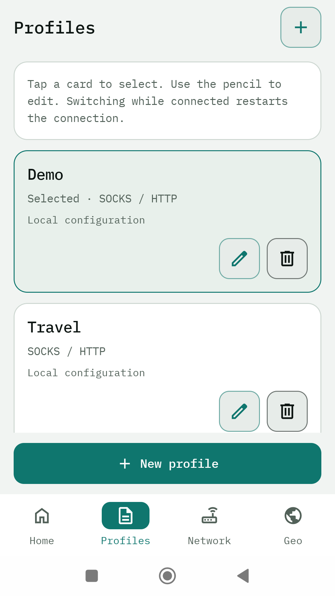
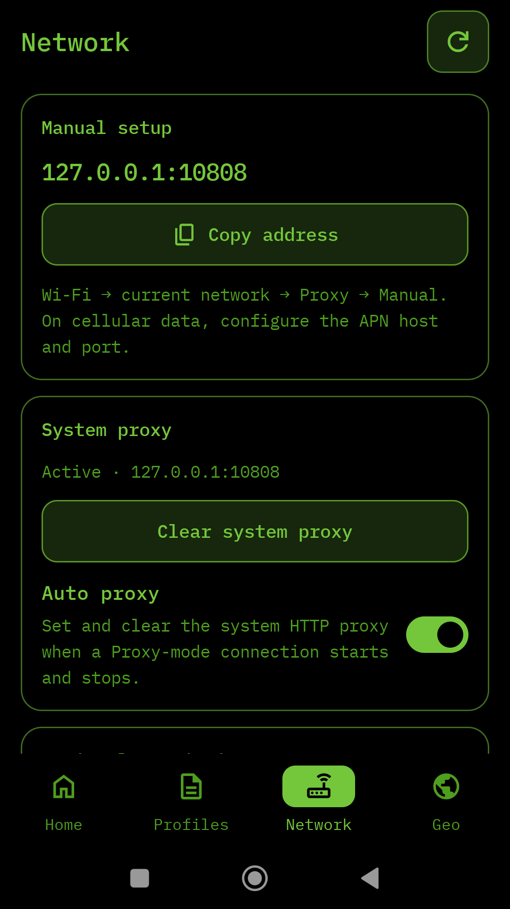
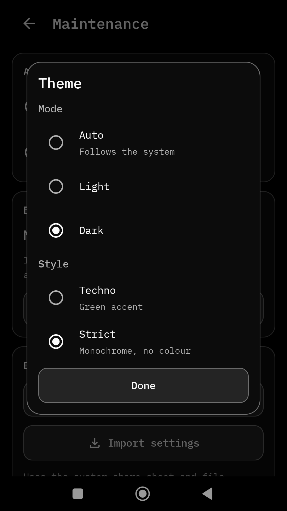

<p align="center">
  
</p>

<h1 align="center">IINV</h1>

<p align="center">
  <a href="https://github.com/evgenyzh/iinv-xray-releases/releases/latest"></a>
  
</p>

**Русский** · [English](#english)

IINV — Android-клиент для Xray. Работает с вашей подпиской или JSON-конфигом:
системный VPN (TUN) либо локальный SOCKS/HTTP-прокси. Без аккаунтов, рекламы и
трекинга.

<!-- latest:start -->
**Последний релиз / Latest release:** [IINV 3.1.1](https://github.com/evgenyzh/iinv-xray-releases/releases/tag/v3.1.1) · 2026-10-25

| Вариант | Файл | Размер |
|:--|:--|--:|
| Full · TUN + proxy | [`iinv-v3.1.1.apk`](https://github.com/evgenyzh/iinv-xray-releases/releases/download/v3.1.1/iinv-v3.1.1.apk) | 140.0 MB |
| Lite · proxy only | [`iinv-lite-v3.1.1.apk`](https://github.com/evgenyzh/iinv-xray-releases/releases/download/v3.1.1/iinv-lite-v3.1.1.apk) | 140.0 MB |

SHA-256:

```text
053693528b68aaffe9d16b829c5ce0d5f671c672fa82e10def6c4a1293b334d2  iinv-v3.1.1.apk
ef9fdd0f8b028ac28535dbfd58f947fbeeca11b28093d10759c93574b79b6cb9  iinv-lite-v3.1.1.apk
```
<!-- latest:end -->

## Скриншоты

<p align="center">
  
  
  
  
</p>

## Возможности

- **Два режима**: системный VPN (TUN) и локальный SOCKS/HTTP-прокси на одном
  порту.
- **Подписки**: ссылки VLESS, VMess, Trojan, Shadowsocks, SOCKS/HTTP,
  Hysteria2, а также Clash YAML и JSON.
- **Шаблоны конфигурации**: порты, `routing`, DNS и правила сохраняются при
  обновлении подписки.
- **Локальные JSON-правки** не затираются: при обновлении показывается diff,
  можно применить версию провайдера или оставить свою.
- **Автопрокси**: включает системный прокси при подключении. Нужно одноразовое
  разрешение через ADB или Shizuku — [инструкция](https://evgenyzh.github.io/iinv-xray-releases/adb.html).
- **Мониторинг**: статистика трафика, состояние серверов и управление
  балансировщиками.
- **Темы**: режим (авто / светлая / тёмная) и стиль (Techno / Strict)
  настраиваются отдельно.
- **Приватность**: без рекламы, аналитики и трекеров; настройки и журналы
  остаются на устройстве.

## Full или Lite

| | Full | Lite |
|---|:---:|:---:|
| Системный VPN (TUN) | да | — |
| Локальный SOCKS/HTTP-прокси | да | да |
| Правила для приложений (App Monitor) | да | — |
| Диагностика и управление через adb | да | — |
| Пакет | `cc.iinv.app` | `cc.iinv.app.lite` |

## Установка

1. Скачайте APK из блока «Последний релиз» или со страницы
   [релизов](https://github.com/evgenyzh/iinv-xray-releases/releases).
2. Если Android попросит, разрешите установку из этого источника.
3. Откройте APK и установите. Приложение не предоставляет серверы: нужна ваша
   подписка или JSON-конфиг.
4. Требуется Android 8.0 или новее.

Для автопрокси (автоматическая установка системного прокси) нужно одноразовое
разрешение через ADB или Shizuku — [инструкция](https://evgenyzh.github.io/iinv-xray-releases/adb.html). Без него используйте TUN-режим
(Full) или настройте прокси в Wi-Fi вручную.

Проверка целостности:

```bash
sha256sum -c SHA256SUMS.txt
```

## Приватность

Приложение не собирает и не передаёт персональные данные. Настройки, профили и
журналы хранятся только на устройстве. Политика конфиденциальности:
[privacy.html](https://evgenyzh.github.io/iinv-xray-releases/privacy.html).

---

## English

IINV is an Android client for Xray. It works with your own subscription or JSON
config: system-wide VPN (TUN) or a local SOCKS/HTTP proxy. No accounts, ads or
tracking.

<p align="center">
  
  
  
  
</p>

### Features

- **Two modes**: system VPN (TUN) and a local SOCKS/HTTP proxy on the same port.
- **Subscriptions**: VLESS, VMess, Trojan, Shadowsocks, SOCKS/HTTP and Hysteria2
  links, plus Clash YAML and JSON.
- **Config templates**: ports, `routing`, DNS and rules survive subscription
  updates.
- **Local JSON edits** are preserved: an update shows a diff, so you can apply
  the provider version or keep yours.
- **Auto-proxy**: sets the system proxy when the connection starts. Requires a
  one-time ADB or Shizuku grant — [instructions](https://evgenyzh.github.io/iinv-xray-releases/adb.html#english).
- **Monitoring**: traffic stats, server state and balancer control.
- **Themes**: mode (auto / light / dark) and style (Techno / Strict) are
  configured separately.
- **Privacy**: no ads, analytics or trackers; settings and logs stay on the
  device.

### Full or Lite

| | Full | Lite |
|---|:---:|:---:|
| System VPN (TUN) | yes | — |
| Local SOCKS/HTTP proxy | yes | yes |
| Per-app proxy rules (App Monitor) | yes | — |
| adb diagnostics and control | yes | — |
| Package | `cc.iinv.app` | `cc.iinv.app.lite` |

### Install

1. Download an APK from the latest release block above or from
   [releases](https://github.com/evgenyzh/iinv-xray-releases/releases).
2. Allow installing from this source if Android asks.
3. Open and install. The app does not provide servers: bring your own
   subscription or JSON config.
4. Android 8.0 or newer is required.

Auto-proxy (setting the system proxy automatically) needs a one-time ADB or Shizuku grant
— [instructions](https://evgenyzh.github.io/iinv-xray-releases/adb.html#english). Without it, use TUN mode (Full) or configure the
proxy in Wi-Fi manually.

Verify integrity:

```bash
sha256sum -c SHA256SUMS.txt
```

Privacy policy:
[privacy.html](https://evgenyzh.github.io/iinv-xray-releases/privacy.html).
